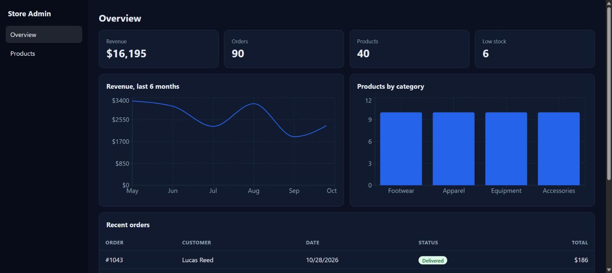
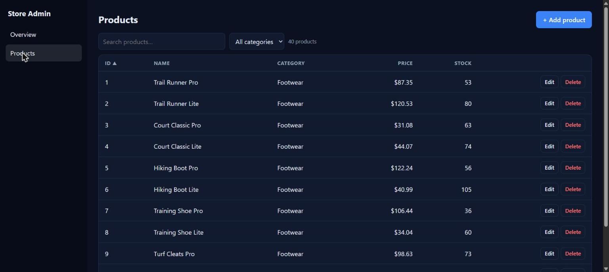

# Store Admin Dashboard

A full-stack admin dashboard for a small online store: sign in, see sales stats and charts, and manage products with search, sorting, filtering, pagination and full create / edit / delete.

**Live demo:** https://store-admin-dashboard-five.vercel.app (the login is prefilled; the API sleeps when idle, so the first sign-in can take about 30 seconds)





**Stack:** React 18 + Vite + Recharts on the front end, Node.js + Express + JWT on the back end. Data is held in memory and re-seeded on every server start, so there is nothing to configure.

## Features

- Login with a JWT-protected API (demo account prefilled)
- Overview page: revenue, orders, products and low-stock counts, revenue-by-month line chart, products-by-category bar chart, recent orders table
- Products page: debounced search, category filter, click-to-sort columns, server-side pagination, add / edit / delete with validation
- Responsive layout and automatic dark mode

## Run it locally

You need Node.js 18 or newer.

```bash
# 1. API (http://localhost:4000)
cd server
npm install
npm start

# 2. Front end (http://localhost:5173), in a second terminal
cd client
npm install
npm run dev
```

Open http://localhost:5173 and sign in with the prefilled demo login (`demo@store.test` / `demo1234`).

## API

| Method | Route | Notes |
| --- | --- | --- |
| POST | `/api/login` | returns a JWT |
| GET | `/api/stats` | totals and chart data |
| GET | `/api/orders` | 8 most recent orders |
| GET | `/api/categories` | category list |
| GET | `/api/products` | `search`, `category`, `sort`, `order`, `page`, `limit` |
| POST | `/api/products` | create (validated) |
| PUT | `/api/products/:id` | update (validated) |
| DELETE | `/api/products/:id` | delete |

All routes except `/api/login` need an `Authorization: Bearer <token>` header.

## Project layout

```
server/   Express API (index.js) and seed data (data.js)
client/   React app (src/App.jsx, src/components/*, src/api.js)
```

## Deploying

1. **API (Render, free tier):** new Web Service from this GitHub repo, root directory `server`, build command `npm install`, start command `npm start`. Add an environment variable `JWT_SECRET` with any long random value.
2. **Front end (Vercel):** import the same repo, root directory `client`, framework Vite. Add an environment variable `VITE_API_URL` set to your Render URL (no trailing slash), then deploy.

The free Render service sleeps when idle, so the first request after a pause can take about 30 seconds. Data resets whenever it restarts, which is fine for a demo.

## Next steps for a real project

Replace the in-memory data with PostgreSQL or MongoDB, hash passwords with bcrypt, and add tests.
